# MineShop

MineShop — магазин товаров для Minecraft-сервера с продажей через Telegram-бота, оплатой ЮKassa,
административной веб-панелью и автоматической выдачей покупок на Paper-сервере.

Проект состоит из четырёх частей:

| Компонент | Назначение | Технологии |
|---|---|---|
| `mineshop-web` | REST API, Telegram-бот, оплата, очередь выдачи, WebSocket для плагина | Java 21, Spring Boot 4, JPA, Caffeine, WebSocket |
| `mineshop-plugin` | Paper-плагин, который выполняет команды выдачи | Java 21, Paper API, JDK WebSocket |
| `mineshop-frontend` | Административная панель | React 18, Vite, Axios |
| PostgreSQL / H2 | Хранение товаров, заказов, пользователей, очереди выдачи | PostgreSQL (prod), H2 (dev) |

---

## Содержание

- [Возможности](#возможности)
- [Архитектура](#архитектура)
- [Быстрый старт](#быстрый-старт)
- [Переменные окружения](#переменные-окружения)
- [Настройка Telegram-бота](#настройка-telegram-бота)
- [Настройка ЮKassa](#настройка-юkassa)
- [Проверка ника Minecraft](#проверка-ника-minecraft)
- [Плагин выдачи](#плагин-выдачи)
- [Кэширование](#кэширование)
- [Production-развёртывание](#production-развёртывание)
- [REST API](#rest-api)
- [Статусы заказов](#статусы-заказов)
- [Скриншоты](#скриншоты)
- [Тесты](#тесты)
- [Структура проекта](#структура-проекта)
- [Безопасность](#безопасность)
- [Диагностика](#диагностика)
- [Ограничения](#ограничения)

---

## Возможности

### Магазин в Telegram

- `/start` — регистрация пользователя и главное меню.
- Привязка ника Minecraft с проверкой формата и существования ника через Mojang API.
- Главное меню: магазин, история покупок, активные заказы, смена ника.
- Магазин:
  - популярные товары;
  - каталог с постраничной навигацией;
  - поиск по названию и описанию (без учёта регистра, с пагинацией).
- Карточка товара: обложка, описание, цена, кнопка «Купить».
- Оформление заказа: создаётся заказ, платёж ЮKassa и ссылка на оплату.
- Страница заказа: «Оплатить», «Я оплатил», «Отменить».
- После оплаты или отмены заказ попадает в историю покупок с актуальным статусом.
- Если игрок офлайн, оплаченный заказ остаётся в очереди и выдаётся при его входе.
- Локализация всех текстов бота в `localization.yml`.

### Административная панель

- Вход по логину и паролю, Bearer-токены с истечением.
- Дашборд: заказы, активные заказы, товары, пользователи, последние покупки.
- Товары: создание, редактирование, удаление, активация/деактивация, загрузка обложки, команда выдачи.
- Заказы: список, фильтр активных, детали, ручное изменение статуса.
- Пользователи: профиль, платформа, Minecraft-ник, история заказов.
- Администраторы: создание и удаление учётных записей.

### Выдача на Minecraft-сервере

- Paper-плагин подключается к бэкенду по WebSocket.
- Бэкенд отправляет заказ сразу после оплаты.
- Плагин выполняет команду на главном потоке сервера и возвращает результат.
- Если сервер выключен или игрок не в сети, заказ остаётся в очереди `order_deliveries`.
- При запуске плагин запрашивает все невыданные заказы.
- При входе игрока плагин запрашивает его заказы отдельно.
- После исчерпания попыток заказ переводится в `PENDING_DELIVERY` для ручной выдачи.

---

## Архитектура

```text
┌──────────────────────┐        HTTPS         ┌─────────────────────────────┐
│  Telegram пользователь│ ───────────────────► │  mineshop-web               │
│  (бот, кнопки)        │                      │  Spring Boot                │
└──────────────────────┘                      │                             │
                                              │  ┌───────────────────────┐  │
┌──────────────────────┐        HTTPS         │  │ Telegram bot pipeline │  │
│  Админ-панель (React) │ ───────────────────► │  │ REST API              │  │
└──────────────────────┘                      │  │ ЮKassa                │  │
                                              │  │ Очередь выдачи        │  │
┌──────────────────────┐        WSS/WS        │  └──────────┬────────────┘  │
│  Paper + MineShop     │ ◄──────────────────► │             │              │
│  plugin               │   delivery / result  │  PostgreSQL │              │
└──────────────────────┘                      └─────────────┼──────────────┘
                                                            │
                                                   orders / order_deliveries
```

Ключевые решения:

- **Заказ и выдача разделены.** `orders` хранит бизнес-статус покупки, `order_deliveries` — техническое
  состояние выдачи (попытки, ошибки, снимок ника и команды).
- **Событие после коммита.** Платёж и постановка в очередь выполняются в одной транзакции; плагину
  заказ отправляется через `@TransactionalEventListener(AFTER_COMMIT)`.
- **Двусторонний WebSocket.** Бэкенд присылает `deliver`, плагин отвечает `delivery_result` с успехом
  или причиной ошибки.
- **At-least-once.** При потере ответа возможна повторная выдача; плагин хранит неотправленные
  результаты в памяти и отправляет их после переподключения.

---

## Быстрый старт

### Требования

- Java 21+
- Node.js 20+ и npm
- Gradle оборачивается в `./gradlew`
- Telegram-бот (токен от [@BotFather](https://t.me/BotFather))
- Магазин ЮKassa (shopId и секретный ключ)
- Paper 1.21.8+ для плагина
- PostgreSQL 15+ для production (локально можно H2)

### 1. Клонирование и окружение

```bash
git clone <repo-url> MineShop
cd MineShop
cp .env.example .env
```

Заполните `.env` и экспортируйте переменные в текущую оболочку:

```bash
# Linux/macOS
set -a
source .env
set +a
```

Windows PowerShell:

```powershell
Get-Content .env | ForEach-Object {
  if ($_ -match '^\s*([^#][^=]*)=(.*)$') {
    [Environment]::SetEnvironmentVariable($matches[1].Trim(), $matches[2].Trim(), 'Process')
  }
}
```

> Spring Boot не читает `.env` автоматически. В production переменные передаются через systemd
> `EnvironmentFile`, Docker secrets или переменные окружения контейнера.

### 2. Запуск бэкенда (локально, H2)

```bash
./gradlew :mineshop-web:bootRun
```

По умолчанию:

- API: `http://localhost:8080`
- H2: `jdbc:h2:file:./db/local_db`
- health: `http://localhost:8080/actuator/health`
- WebSocket плагина: `ws://localhost:8080/ws/plugin`

### 3. Запуск админ-панели

```bash
cd mineshop-frontend
npm install
npm run dev
```

Vite проксирует `/api` на `http://localhost:8080`. Откройте адрес из вывода Vite (обычно
`http://localhost:5173`).

### 4. Сборка и установка плагина

```bash
./gradlew :mineshop-plugin:shadowJar
```

Готовый файл: `mineshop-plugin/build/libs/mineshop-plugin-1.0.0.jar`.

Скопируйте его в `plugins/` Paper-сервера, запустите сервер, отредактируйте
`plugins/MineShop/config.yml`:

```yaml
backend-url: "ws://127.0.0.1:8080/ws/plugin"
token: "тот-же-токен-что-PLUGIN_TOKEN"
reconnect-seconds: 5
```

### 5. Проверка

- Откройте бота, отправьте `/start`.
- Введите ник Minecraft — он проверится через Mojang API.
- Откройте админ-панель, войдите под `ADMIN_USERNAME` / `ADMIN_PASSWORD`.
- Создайте товар, укажите команду выдачи вида `give %player% diamond 1`.
- Купите товар через бота и нажмите «Я оплатил» после оплаты.
- Убедитесь, что плагин выдал предмет и заказ получил статус «Выдан».

---

## Переменные окружения

### Основные

| Переменная | Обязательна | По умолчанию | Описание |
|---|---:|---|---|
| `TG_TOKEN` | да | — | Токен Telegram-бота |
| `TG_PROXY_ENABLED` | нет | `true` | Использовать SOCKS-прокси для Telegram |
| `TG_PROXY_ADDRESS` | нет | `127.0.0.1:9150` | Адрес SOCKS-прокси |
| `YOOKASSA_SHOP_ID` | да | `1450914` | ID магазина ЮKassa |
| `YOOKASSA_TOKEN` | да | — | Секретный ключ ЮKassa |
| `YOOKASSA_RETURN_URL` | да | `https://t.me` | Куда вернуть пользователя после оплаты |
| `PLUGIN_TOKEN` | да | `change-me` | Общий секрет WebSocket-плагина |
| `ADMIN_USERNAME` | в prod | `admin` | Логин первого администратора |
| `ADMIN_PASSWORD` | да | `change-me-now` | Пароль первого администратора |
| `ADMIN_TOKEN_TTL_HOURS` | нет | `12` | Время жизни админ-токена |
| `SERVER_PORT` | нет | `8080` | Порт HTTP/WebSocket |
| `MEDIA_COVER_ROOT` | нет | `./media/covers` | Каталог обложек товаров |
| `MINECRAFT_PROFILE_CHECK_ENABLED` | нет | `true` | Проверять ник через Mojang |
| `MOJANG_PROFILE_API_URL` | нет | `https://api.mojang.com` | Базовый URL API Mojang |
| `MOJANG_PROFILE_TIMEOUT_MS` | нет | `3000` | Таймаут проверки ника |

### Production-профиль

| Переменная | Описание |
|---|---|
| `SPRING_PROFILES_ACTIVE=prod` | Включает `application-prod.yml` |
| `DB_URL` | JDBC URL PostgreSQL |
| `DB_USERNAME` | Пользователь БД |
| `DB_PASSWORD` | Пароль БД |
| `DB_POOL_SIZE` | Размер HikariCP pool |
| `DB_MIN_IDLE` | Минимум idle-соединений |

Пароль администратора создаётся только при **первом** запуске, если администратора ещё нет.
Смена `ADMIN_PASSWORD` позже не меняет существующий пароль — используйте панель или удалите запись.

---

## Настройка Telegram-бота

1. Создайте бота у [@BotFather](https://t.me/BotFather) командой `/newbot`.
2. Получите токен и задайте `TG_TOKEN`.
3. Если Telegram недоступен напрямую, включите SOCKS-прокси:
   ```env
   TG_PROXY_ENABLED=true
   TG_PROXY_ADDRESS=127.0.0.1:9150
   ```
4. Перезапустите backend. Бот запускается вместе с приложением.
5. Отправьте боту `/start`.

Бот работает только в личных сообщениях (`ChatType.PRIVATE`).

---

## Настройка ЮKassa

1. Зарегистрируйте магазин в ЮKassa.
2. Возьмите `shopId` и секретный ключ API.
3. Заполните:
   ```env
   YOOKASSA_SHOP_ID=123456
   YOOKASSA_TOKEN=live_...
   YOOKASSA_RETURN_URL=https://t.me/your_bot
   ```
4. При покупке backend создаёт платёж и получает `confirmation_url`.
5. Кнопка «Оплатить» в боте — URL-кнопка на страницу ЮKassa.
6. Кнопка «Я оплатил» проверяет платёж через API ЮKassa; статус заказа меняется только после
   подтверждения оплаты.

Если ваш магазин требует чек по 54-ФЗ, добавьте передачу `Receipt` в `PaymentCreateData`
(в текущей реализации чек не передаётся).

---

## Проверка ника Minecraft

Проверка выполняется в `SetNameRoute` через `MinecraftProfileService`:

1. Ник проверяется регулярным выражением `^[A-Za-z0-9_]{3,16}$`.
2. Запрос идёт на `https://api.mojang.com/users/profiles/minecraft/{nickname}`.
3. Если ник найден, сохраняется **каноническое** написание из ответа Mojang.
4. Если ник не найден — бот просит проверить написание.
5. Если API недоступен — ник не сохраняется, бот просит попробовать позже.

Отключить проверку для offline-mode сервера:

```env
MINECRAFT_PROFILE_CHECK_ENABLED=false
```

Результаты (включая отрицательные) кэшируются на 10 минут, поэтому повторные вводы не создают
нагрузку на Mojang и не упираются в rate limit.

---

## Плагин выдачи

Подробная инструкция — в [`mineshop-plugin/README.md`](mineshop-plugin/README.md).

Кратко:

```bash
./gradlew :mineshop-plugin:shadowJar
```

- jar: `mineshop-plugin/build/libs/mineshop-plugin-1.0.0.jar`
- конфиг: `plugins/MineShop/config.yml`
- `token` должен совпадать с `PLUGIN_TOKEN` backend
- при HTTPS используйте `wss://`
- команда выдачи поддерживает `%player%` и `%amount%`

### Как работает очередь

1. После оплаты заказ получает `PAID`, в `order_deliveries` создаётся запись `PENDING`.
2. Если плагин подключён, backend отправляет `deliver`.
3. Плагин проверяет, что игрок онлайн, выполняет команду и отправляет `delivery_result`.
4. Успех → `orders.status = DELIVERED`, `order_deliveries.status = DELIVERED`.
5. Игрок офлайн → `PLAYER_OFFLINE`, запись возвращается в `PENDING`; при входе игрока плагин
   отправляет `player_online`, и backend присылает его заказы.
6. Сервер выключен → запись остаётся `PENDING`; при запуске плагин делает `sync`.
7. После `PLUGIN_MAX_ATTEMPTS` попыток заказ получает `PENDING_DELIVERY` для ручной выдачи.

---

## Кэширование

Используется Caffeine (`CacheConfig`):

| Кэш | TTL | Что кэшируется |
|---|---:|---|
| `minecraft-profiles` | 10 минут | Положительные и отрицательные ответы Mojang |
| `product-search` | 60 секунд | Результаты поиска по запросу и странице |
| `product-catalog` | 60 секунд | Страницы каталога товаров |

Кэш товаров сбрасывается при создании, редактировании, удалении, смене активности и загрузке
обложки. Кэш профилей уменьшает количество запросов к Mojang и защищает от rate limit.

Метрики кэшей доступны через Actuator, если включить `metrics` в `management.endpoints.web.exposure.include`.

---

## Production-развёртывание

### 1. PostgreSQL

```sql
CREATE USER mineshop WITH PASSWORD 'strong-password';
CREATE DATABASE mineshop OWNER mineshop;
```

Hibernate обновляет схему при старте (`ddl-auto: update`). Перед обновлением приложения делайте
резервную копию БД; для больших проектов рекомендуется перейти на Flyway/Liquibase.

### 2. Сборка backend

```bash
./gradlew :mineshop-web:bootJar
```

Jar: `mineshop-web/build/libs/mineshop-web-*.jar`.

Запуск:

```bash
export SPRING_PROFILES_ACTIVE=prod
java -jar mineshop-web/build/libs/mineshop-web-*.jar
```

Или через systemd (пример):

```ini
[Unit]
Description=MineShop backend
After=network.target postgresql.service

[Service]
User=mineshop
WorkingDirectory=/opt/mineshop
EnvironmentFile=/etc/mineshop/mineshop.env
ExecStart=/usr/bin/java -Xms256m -Xmx1g -jar /opt/mineshop/mineshop-web.jar
Restart=always
RestartSec=5
SuccessExitStatus=143

[Install]
WantedBy=multi-user.target
```

### 3. Сборка frontend

```bash
cd mineshop-frontend
npm ci
npm run build
```

Результат — `mineshop-frontend/dist`. Раздавайте его через Nginx.

### 4. Nginx + WebSocket

```nginx
server {
    listen 80;
    server_name shop.example.com;

    root /var/www/mineshop;
    index index.html;

    location / {
        try_files $uri $uri/ /index.html;
    }

    location /api/ {
        proxy_pass http://127.0.0.1:8080;
        proxy_set_header Host $host;
        proxy_set_header X-Real-IP $remote_addr;
        proxy_set_header X-Forwarded-For $proxy_add_x_forwarded_for;
        proxy_set_header X-Forwarded-Proto $scheme;
    }

    location /ws/plugin {
        proxy_pass http://127.0.0.1:8080;
        proxy_http_version 1.1;
        proxy_set_header Upgrade $http_upgrade;
        proxy_set_header Connection "upgrade";
        proxy_set_header Host $host;
        proxy_read_timeout 3600s;
        proxy_send_timeout 3600s;
    }

    location /actuator/health {
        proxy_pass http://127.0.0.1:8080;
    }
}
```

Для HTTPS используйте Certbot/Let's Encrypt. После настройки HTTPS в конфиге плагина указывайте
`wss://shop.example.com/ws/plugin`.

### 5. Проверка production

```bash
curl https://shop.example.com/actuator/health
```

Ожидаемый ответ: `{"status":"UP"}`.

---

## REST API

Все `/api/**`, кроме логина, требуют `Authorization: Bearer <token>`.

### Авторизация

| Метод | Путь | Описание |
|---|---|---|
| `POST` | `/api/admin/auth/login` | Вход, возвращает токен |
| `POST` | `/api/admin/auth/logout` | Выход |
| `GET` | `/api/admin/auth/me` | Текущий администратор |

### Товары

| Метод | Путь | Описание |
|---|---|---|
| `GET` | `/api/product/{id}` | Товар |
| `GET` | `/api/product/list/{page}` | Список товаров |
| `PUT` | `/api/product/create` | Создать товар |
| `POST` | `/api/product/edit/{id}` | Изменить товар |
| `DELETE` | `/api/product/{id}` | Удалить товар |
| `POST` | `/api/product/active` | Включить/выключить товар |
| `POST` | `/api/product/cover/{id}` | Загрузить обложку (multipart) |
| `GET` | `/api/product/cover/{id}` | Получить обложку |

### Заказы

| Метод | Путь | Описание |
|---|---|---|
| `GET` | `/api/order/{id}` | Заказ по UUID |
| `GET` | `/api/order/list/{page}` | Все заказы |
| `GET` | `/api/order/active/list/{page}` | Активные (`PENDING`) |
| `POST` | `/api/order/status` | Изменить статус |

### Пользователи

| Метод | Путь | Описание |
|---|---|---|
| `GET` | `/api/user/{id}` | Пользователь (`TELEGRAM@123`) |
| `GET` | `/api/user/history/{id}/{page}` | История заказов |
| `GET` | `/api/user/list/{page}` | Список пользователей |

### Администраторы

| Метод | Путь | Описание |
|---|---|---|
| `GET` | `/api/admin/admins` | Список администраторов |
| `PUT` | `/api/admin/create` | Создать администратора |
| `DELETE` | `/api/admin/delete/{username}` | Удалить администратора |

### Служебные

| Путь | Описание |
|---|---|
| `GET /actuator/health` | Health-check (БД, приложение) |
| `WS /ws/plugin` | WebSocket для Paper-плагина (токен в `hello`) |

---

## Статусы заказов

### `OrderStatus`

| Статус | Значение |
|---|---|
| `PENDING` | Создан, ждёт оплаты |
| `PAID` | Оплачен, ожидает выдачи |
| `DELIVERED` | Выдан игроку |
| `PENDING_DELIVERY` | Оплачен, но требуется ручная выдача |
| `CANCELED` | Отменён |

### `DeliveryStatus` (`order_deliveries`)

| Статус | Значение |
|---|---|
| `PENDING` | Ждёт отправки плагину |
| `IN_PROGRESS` | Отправлено, ждём ответ |
| `DELIVERED` | Плагин подтвердил выдачу |
| `FAILED` | Исчерпаны попытки, нужна ручная выдача |

---

## Скриншоты

> Вставьте изображения в `docs/screenshots/` с указанными именами. Ниже описано, что должно быть
> на каждом скриншоте.

### 1. Telegram — главное меню

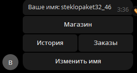

**Что должно быть изображено:** сообщение «Ваше имя: <ник>» и inline-кнопки «Магазин», «История»,
«Заказы», «Изменить имя».

### 2. Telegram — меню магазина

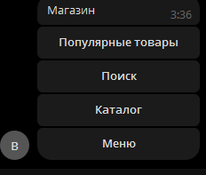

**Что должно быть изображено:** сообщение «Магазин» и кнопки «Популярные товары», «Поиск»,
«Каталог», «Меню».

### 3. Telegram — поиск товара

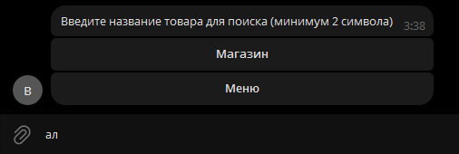

**Что должно быть изображено:** сообщение «Введите название товара для поиска (минимум 2 символа)»
и кнопки «Магазин», «Меню».

### 4. Telegram — результаты поиска

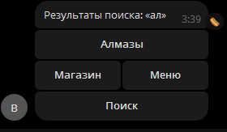

**Что должно быть изображено:** заголовок «Результаты поиска: «...»», список товаров кнопками,
пагинация «Назад/Вперёд», кнопки «Поиск», «Магазин», «Меню».

### 5. Telegram — карточка товара

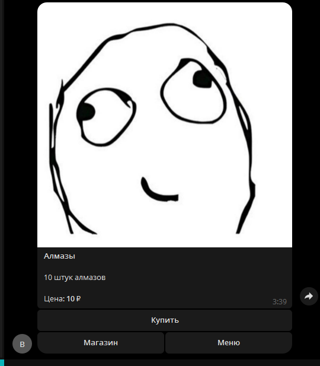

**Что должно быть изображено:** фото товара, название, описание, цена и кнопки «Купить»,
«Магазин», «Меню».

### 6. Telegram — страница заказа

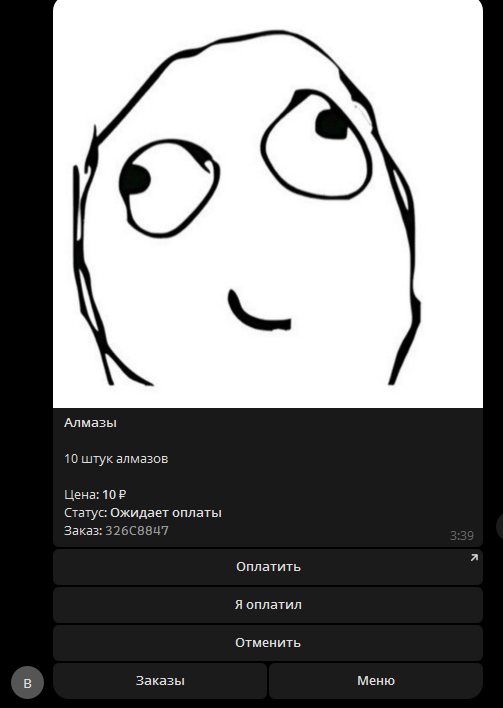

**Что должно быть изображено:** фото/описание товара, цена, статус «Ожидает оплаты», номер заказа,
кнопки «Оплатить», «Я оплатил», «Отменить», «Заказы», «Меню».

### 7. Telegram — активные заказы

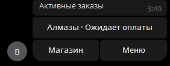

**Что должно быть изображено:** список товаров со статусами, пагинация и кнопки «Магазин», «Меню».

### 8. Telegram — история покупок

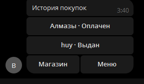

**Что должно быть изображено:** список оплаченных/отменённых товаров со статусами («Оплачен»,
«Выдан», «Отменён»), пагинация.

### 9. Telegram — страница оплаченного заказа

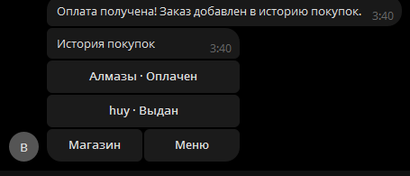

**Что должно быть изображено:** карточка заказа со статусом «Оплачен» или «Выдан», без кнопок оплаты
и отмены, с кнопками «История» и «Меню».

### 10. Telegram — смена ника и ошибка проверки

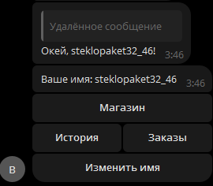

**Что должно быть изображено:** сообщение «Ваш ник на сервере?» и ответ бота об ошибке
«Игрок с таким ником не найден в Minecraft» либо «Не удалось проверить ник...».

### 11. Админ-панель — вход

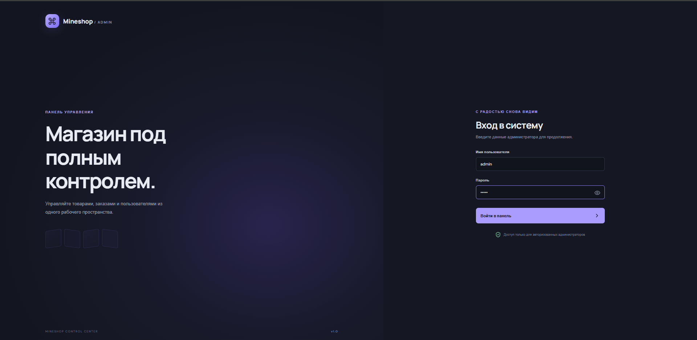

**Что должно быть изображено:** экран входа с логотипом Mineshop, полями «Имя пользователя»,
«Пароль» и кнопкой «Войти в панель».

### 12. Админ-панель — обзор

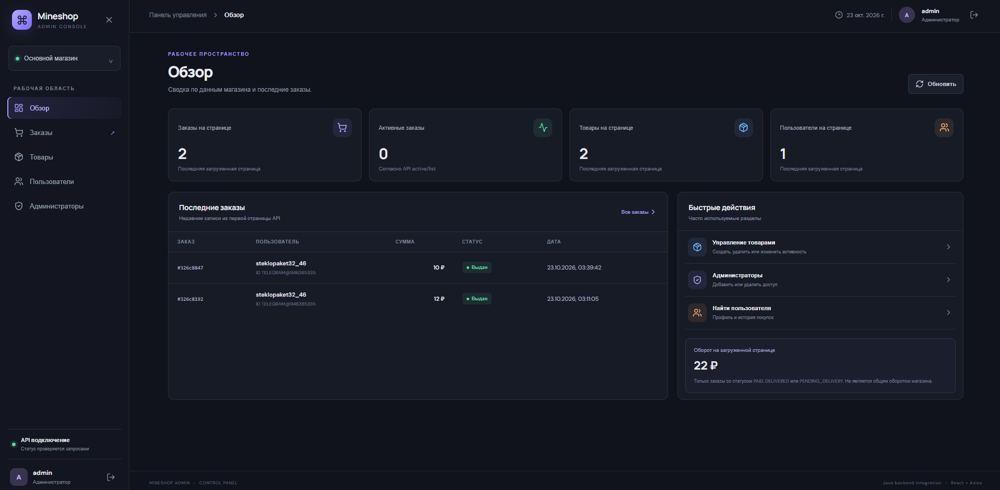

**Что должно быть изображено:** боковое меню, карточки «Заказы», «Активные заказы», «Товары»,
«Пользователи», таблица последних заказов и блок быстрых действий.

### 13. Админ-панель — товары

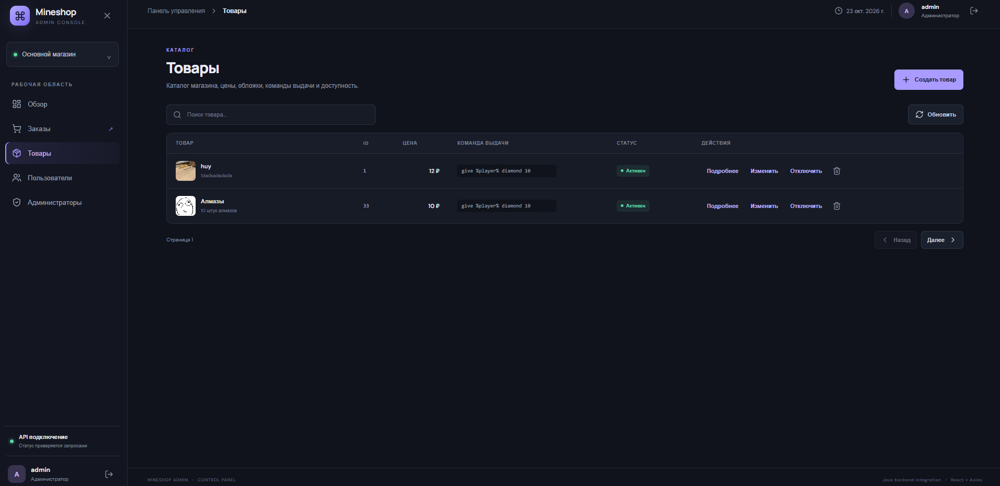

**Что должно быть изображено:** таблица товаров с обложками, ценами, командами выдачи, статусами,
кнопками «Подробнее», «Изменить», «Отключить», «Удалить» и кнопкой «Создать товар».

### 14. Админ-панель — редактирование товара

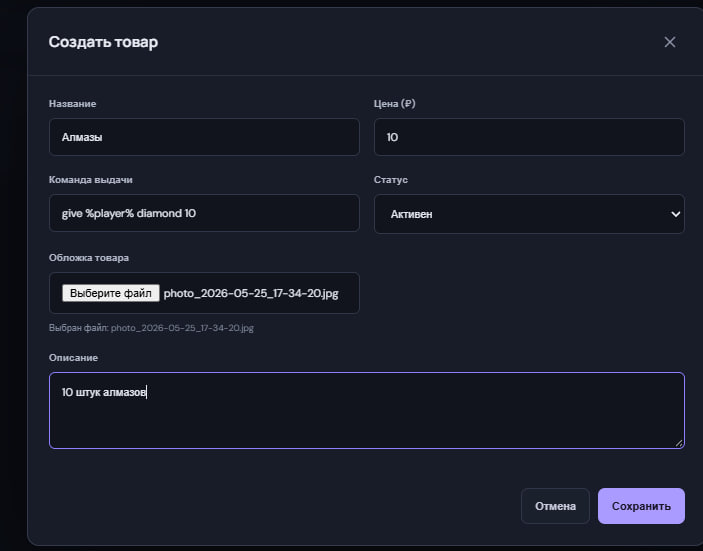

**Что должно быть изображено:** модальное окно с полями «Название», «Цена», «Команда выдачи»,
«Статус», «Обложка товара», «Описание» и кнопками «Отмена»/«Сохранить».

### 15. Админ-панель — заказы

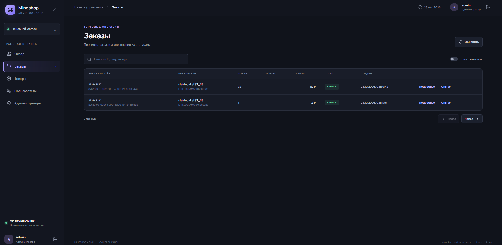

**Что должно быть изображено:** таблица заказов с ID, покупателем, товаром, количеством, суммой,
статусом, датой и кнопками «Подробнее»/«Статус», фильтр «Только активные».

### 16. Админ-панель — изменение статуса заказа

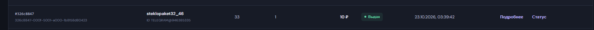

**Что должно быть изображено:** модальное окно «Изменить статус заказа» с выпадающим списком
`PENDING`, `PAID`, `DELIVERED`, `PENDING_DELIVERY`, `CANCELED`.

### 17. Админ-панель — пользователи и история

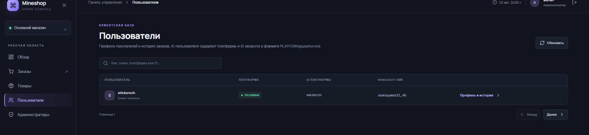

**Что должно быть изображено:** таблица пользователей (платформа, ID, ник Minecraft), модальное окно
профиля с историей заказов и пагинацией.

### 18. Админ-панель — администраторы

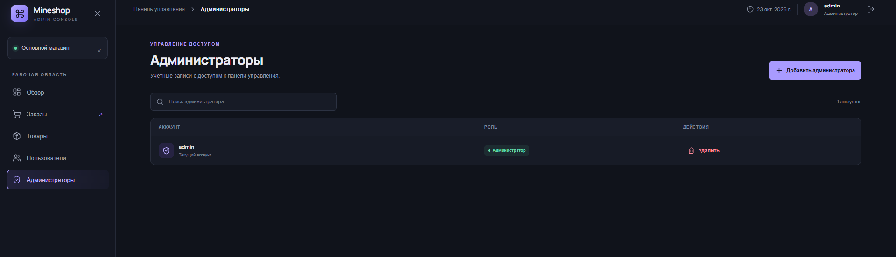

**Что должно быть изображено:** список администраторов, кнопка «Добавить администратора», модальное
окно создания с логином и паролем.

---

## Тесты

```bash
./gradlew :mineshop-web:test
```

Покрыто:

- поиск товаров и пагинация;
- нормализация поискового запроса;
- локализация (все ключи присутствуют);
- сценарии Telegram-бота (поиск, покупка, заказ, оплата, отмена, история);
- оплата и отмена заказа;
- очередь выдачи: успех, ошибка, офлайн-игрок, лимит попыток, синхронизация;
- проверка ника и поведение при недоступности Mojang;
- репозитории заказов и очереди на H2.

Проверка frontend:

```bash
cd mineshop-frontend
npm run build
```

Проверка плагина:

```bash
./gradlew :mineshop-plugin:shadowJar
```

---

## Структура проекта

```text
MineShop/
├── mineshop-web/                 # backend
│   └── src/main/java/ru/stickoroch/mineshop/
│       ├── bot/                  # Telegram: роутинг, сессии, экраны
│       ├── core/                 # JPA-сущности и репозитории
│       └── web/
│           ├── admin/            # безопасность админки
│           ├── cache/            # Caffeine
│           ├── controller/       # REST API
│           ├── delivery/         # очередь выдачи
│           ├── minecraft/        # проверка ника Mojang
│           ├── plugin/           # WebSocket для Paper
│           ├── service/          # бизнес-логика
│           └── media/            # обложки товаров
├── mineshop-plugin/              # Paper-плагин
├── mineshop-frontend/            # React-админка
├── docs/screenshots/             # скриншоты для README
├── .env.example
├── README.md
└── mineshop-web/src/main/resources/
    ├── application.yml           # общие настройки
    ├── application-prod.yml      # production-профиль
    └── localization.yml          # тексты бота
```

---

## Безопасность

- Все `/api/**`, кроме `/api/admin/auth/login`, требуют Bearer-токен.
- Пароли администраторов хранятся в BCrypt.
- Админ-токены хранятся в БД в виде SHA-256 хеша и имеют срок жизни.
- WebSocket плагина защищён общим секретом `PLUGIN_TOKEN`.
- Обязательно смените `PLUGIN_TOKEN`, `ADMIN_PASSWORD`, `YOOKASSA_TOKEN` перед публикацией.
- Используйте HTTPS и `wss://` в production.
- Не публикуйте порт 8080 напрямую; используйте reverse proxy.
- Загружаются только JPEG, PNG и WebP; размер ограничен настройками multipart.
- Обложки проверяются на выход за пределы каталога.

---

## Диагностика

| Проблема | Что проверить |
|---|---|
| Бот не запускается | `TG_TOKEN`, доступ к `api.telegram.org`, настройки прокси |
| Ошибка ЮKassa | `YOOKASSA_SHOP_ID`, `YOOKASSA_TOKEN`, доступ к API |
| Плагин не подключается | `backend-url`, `PLUGIN_TOKEN`, Nginx `Upgrade`/`Connection`, `wss://` |
| Заказ оплачен, но не выдан | `order_deliveries`: статус, `last_error`, онлайн ли игрок, запущен ли плагин |
| Ник не сохраняется | Mojang API, rate limit, `MINECRAFT_PROFILE_CHECK_ENABLED` |
| 401 в админке | Токен истёк, неверный `ADMIN_PASSWORD`, перезапустите вход |
| 403/1008 WebSocket | Не совпадает токен backend/plugin |
| Пустые списки в админке | Нет данных на странице или ошибка API; смотрите `actuator/health` и логи |
| H2 database is locked | Остановите второй экземпляр backend или используйте PostgreSQL |

Логи backend:

```bash
journalctl -u mineshop -f
```

Логи Paper:

```bash
tail -f logs/latest.log
```

---

## Ограничения

- Очередь выдачи рассчитана на один активный Minecraft-сервер.
- Доставка работает по принципу at-least-once: при потере ответа возможна повторная выдача.
- ЮKassa-чек (54-ФЗ) не формируется; при необходимости добавьте `Receipt` в создание платежа.
- Схема БД обновляется Hibernate (`ddl-auto: update`); для крупного production рекомендуется
  перейти на миграции Flyway/Liquibase.
- Админ-панель и backend — отдельные артефакты; в примере они объединяются через Nginx.

---

## Лицензия

Учебный проект. Добавьте лицензию перед публикацией в открытый доступ.
